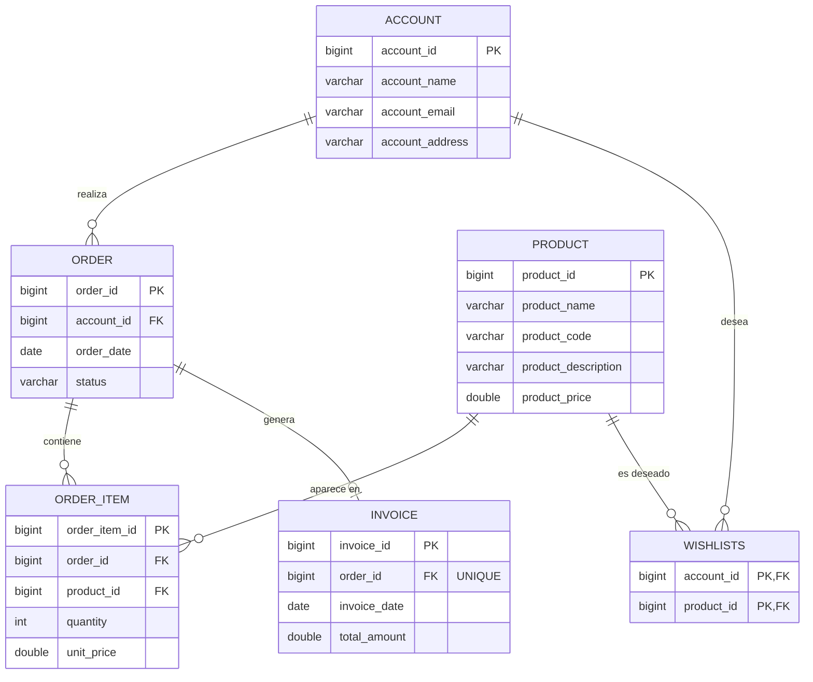

<div align="center">

# 🛒 Tienda · API REST multitabla

### Spring Boot + JPA + MySQL con relaciones 1:n, 1:1 y n:m


*Escuela Profesional Vedruna Sevilla · 2º DAM · Optativa AN6367 · Microservicios*

</div>

---

Una tienda online pequeña para aprender a trabajar con **varias tablas relacionadas** en una API REST: cuentas de usuario, productos, listas de deseos, pedidos con sus líneas y facturas.

## 🎯 Qué vas a aprender

- Modelar relaciones **1:n**, **1:1** y **n:m** con JPA.
- Separar entidades y **DTOs**, y pasar de unos a otros con **converters**.
- Poner **lógica de negocio** en la capa de servicio (`placeOrder`) con `@Transactional`.
- Hacer **consultas por padre** con Spring Data (`findByOrderId`).
- Devolver los códigos HTTP correctos (**404** y **400**) con excepciones propias.

---

## 🗺️ Modelo de datos



> El mismo modelo está dibujado a mano en `ER_tienda.excalidraw` (se abre con la extensión de Excalidraw de VS Code).

### 🔗 Relaciones y cómo se mapean en JPA

| Relación | Tipo | En el código |
|----------|:----:|--------------|
| `Account` → `Order` | 1:n | `@OneToMany(mappedBy = "account")` en `Account` y `@ManyToOne` con `@JoinColumn` en `Order` |
| `Order` → `OrderItem` | 1:n | `@ManyToOne` en `OrderItem` |
| `Product` → `OrderItem` | 1:n | `@ManyToOne` en `OrderItem` |
| `Order` → `Invoice` | 1:1 | `@OneToOne` con `@JoinColumn(unique = true)` en `Invoice` |
| `Account` ↔ `Product` (lista de deseos) | n:m | `@ManyToMany` con `@JoinTable(name = "wishlists")` en `Account` |

> 💡 `Order` y `Product` también están en una relación n:m, pero con **datos propios** (`quantity` y `unit_price`). Cuando la relación tiene atributos, deja de ser una simple tabla intermedia y pasa a ser una **entidad**: `OrderItem`. Es la diferencia entre la lista de deseos y las líneas de un pedido.

---

## 🏷️ Anotaciones JPA: qué significa cada una

Hibernate lee las anotaciones de las entidades y las traduce a tablas, columnas y claves foráneas. Aquí están todas las que usa `tienda`, con lo que significa cada una.

| Anotación | Dónde se pone | Qué hace |
|-----------|---------------|----------|
| `@Entity` | Clase | Esta clase representa una tabla |
| `@Table(name = "orders")` | Clase | Nombre de la tabla en MySQL |
| `@Id` + `@GeneratedValue(IDENTITY)` | Atributo | Clave primaria que MySQL autoincrementa |
| `@Column(name = "order_date")` | Atributo | Nombre de la columna en MySQL |
| `@ManyToOne` | Lado "muchos" | Muchos objetos apuntan a uno. **Aquí vive la clave foránea** |
| `@OneToMany(mappedBy = ...)` | Lado "uno" | La lista de hijos. **No crea ninguna columna**, es el espejo del `@ManyToOne` |
| `@OneToOne` | Cualquier lado | Un objeto se corresponde con exactamente otro |
| `@ManyToMany` + `@JoinTable` | Cualquier lado | Muchos a muchos mediante una tabla intermedia |
| `@JoinColumn` | Atributo con relación | Nombre de la columna de la clave foránea |
| `fetch` | Dentro de la relación | **Cuándo** se cargan los datos relacionados |
| `cascade` | Dentro de la relación | Qué operaciones se contagian a los objetos relacionados |

> 💡 `Order` es una palabra reservada de SQL, por eso la entidad se llama `Order` pero la tabla `orders` (`@Table(name = "orders")`).

### 🔗 `@ManyToOne` y `@OneToMany`: las dos caras de una 1:n

Un cliente tiene muchos pedidos, y cada pedido pertenece a un solo cliente:

```java
// Order.java  → el lado "muchos": aquí está la clave foránea
@ManyToOne(fetch = FetchType.LAZY)
@JoinColumn(name = "account_id", referencedColumnName = "account_id")
Account account;

// Account.java → el lado "uno": solo es la lista, no crea columnas
@OneToMany(mappedBy = "account", cascade = CascadeType.ALL, fetch = FetchType.LAZY)
List<Order> orderList;
```

La tabla `orders` tiene una columna `account_id`. La tabla `accounts` **no tiene ninguna columna de pedidos**. Por eso se dice que `Order` es el **lado propietario** de la relación: quien tiene la clave foránea manda.

- `mappedBy = "account"` significa *"esta lista es el espejo de la relación que ya está definida en el atributo `account` de `Order`"*.
- Al guardar, Hibernate **solo mira el lado propietario**. Si añades un pedido a `account.getOrderList()` pero no haces `order.setAccount(account)`, la columna `account_id` se queda a `NULL`.

### 1️⃣ `@OneToOne`: la factura de un pedido

```java
// Invoice.java
@OneToOne(fetch = FetchType.LAZY)
@JoinColumn(name = "order_id", referencedColumnName = "order_id", unique = true)
Order order;
```

Por debajo es igual que una 1:n, con la diferencia de `unique = true`: MySQL no permite repetir el mismo `order_id` en dos facturas. Sin ese `unique`, sería en realidad una 1:n disfrazada. La clave foránea está en `invoices`, así que `Invoice` es el lado propietario.

### 🧷 `@JoinColumn`: `name` y `referencedColumnName`

Esta es la parte que más confunde. La regla es:

> **Los dos valores son nombres de columnas de la base de datos, no nombres de atributos Java.**

| Parámetro | Qué es | En `Order.account` |
|-----------|--------|--------------------|
| `name` | Columna de la clave foránea, **en la tabla de esta entidad** | `orders.account_id` |
| `referencedColumnName` | Columna **a la que apunta**, en la otra tabla (normalmente su clave primaria) | `accounts.account_id` |

El resultado en SQL es:

```sql
FOREIGN KEY (account_id) REFERENCES accounts(account_id)
--           └ name                           └ referencedColumnName
```

Truco para recordarlo: **`name` = mi tabla, `referencedColumnName` = la otra tabla.** En `tienda` coinciden porque llamamos igual a las dos columnas, pero podrían ser distintas: `@JoinColumn(name = "buyer_id", referencedColumnName = "account_id")` crearía `orders.buyer_id`. Si `referencedColumnName` apunta a la clave primaria, se puede omitir.

Para no confundir qué nombre es de la base de datos y cuál de Java:

| Se refiere a la **base de datos** (columnas y tablas) | Se refiere a **Java** (atributos) |
|-------|-------|
| `@Table(name)`, `@Column(name)` | `mappedBy = "account"` |
| `@JoinColumn(name, referencedColumnName)` | Métodos derivados: `findByOrderId` (= `order.id`) |
| `@JoinTable(name, joinColumns, inverseJoinColumns)` | Los `get`/`set` y los DTOs |

Como en el proyecto `ddl-auto` está a `none`, Hibernate **no crea las tablas**: si el `name` no coincide con el `db.sql`, la app falla al consultar con `Unknown column`.

### 🔀 `@JoinTable`: la tabla intermedia de una n:m

```java
// Account.java
@ManyToMany(fetch = FetchType.LAZY)
@JoinTable(name = "wishlists",
    joinColumns        = @JoinColumn(name = "account_id", referencedColumnName = "account_id"),
    inverseJoinColumns = @JoinColumn(name = "product_id", referencedColumnName = "product_id"))
Set<Product> wishList;
```

- `name`: la tabla intermedia (`wishlists`), que no tiene entidad Java propia.
- `joinColumns`: la columna que apunta **a esta entidad** (`Account`).
- `inverseJoinColumns`: la columna que apunta **a la otra entidad** (`Product`).

El `@JoinTable` se pone en un solo lado, y ese lado es el propietario. Si pusieras otro `@ManyToMany` en `Product`, debería llevar `mappedBy = "wishList"`. Una tabla intermedia solo puede tener las dos claves; si necesita datos propios (cantidad, precio), hay que convertirla en entidad: `OrderItem`.

### 💤 `fetch`: `LAZY` frente a `EAGER`

`fetch` decide **cuándo se leen de la base de datos** los objetos relacionados.

| | `LAZY` (perezoso) | `EAGER` (ansioso) |
|--|-------------------|-------------------|
| Cuándo carga | Solo cuando llamas al getter (`account.getOrderList()`) | Siempre, junto con la entidad principal |
| Consultas | Una extra, bajo demanda | Un `JOIN` o consultas extra, las necesites o no |
| Riesgo | `LazyInitializationException` si lees fuera de la sesión | Cargas enormes de datos que nadie pidió |

Los valores por defecto de JPA son `@ManyToOne` y `@OneToOne` → **EAGER**, y `@OneToMany` y `@ManyToMany` → **LAZY**. En `tienda` ponemos `LAZY` en todas de forma explícita, que es la buena práctica. `EAGER` no lo usamos, pero conviene conocerlo porque aparece en muchos ejemplos de internet.

> ℹ️ Cargar una `Account` no trae sus pedidos: se leen cuando el converter llama a `getOrderList()`. Funciona porque Spring Boot mantiene la sesión abierta durante toda la petición (`spring.jpa.open-in-view`, activado por defecto). Si el converter se ejecutara fuera de esa sesión, saltaría `LazyInitializationException`.

### 🌊 `cascade`: propagar operaciones

`cascade` hace que lo que le haces al padre se repita automáticamente en los hijos.

| Tipo | Se propaga... |
|------|---------------|
| `PERSIST` | Al guardar el padre, se guardan los hijos nuevos |
| `MERGE` | Al actualizar el padre, se actualizan los hijos |
| `REMOVE` | Al borrar el padre, se borran los hijos |
| `REFRESH`, `DETACH` | Recarga y desvinculación (se usan muy poco) |
| `ALL` | Todos los anteriores |

En `Account.orderList` está `CascadeType.ALL`: si guardas o borras una cuenta, haces lo mismo con sus pedidos. Tres advertencias:

1. **Solo tiene sentido de padre a hijo "propio"**, donde el hijo no existe sin el padre (pedido → líneas). Nunca lo pongas en una `@ManyToMany` como la lista de deseos: borrar una cuenta con `REMOVE` **borraría los productos** de su lista.
2. **No sustituye a las claves foráneas.** Si borras una cuenta, JPA intenta borrar sus pedidos, pero esos pedidos pueden tener `order_items` o una `invoice`, y MySQL rechaza el borrado con un error de integridad. La cascada solo llega un nivel, salvo que lo declares también en `Order`.
3. `cascade` no es lo mismo que `ON DELETE CASCADE` de MySQL: el primero lo hace Hibernate al ejecutar tu código, el segundo lo hace la base de datos por sí sola.

---

## 🪜 Cómo construirlo en clase: de lo simple a lo real

Con todas las relaciones de golpe es fácil perderse. Se puede construir `tienda` por fases, y cada fase añade **una sola idea nueva**.

| Fase | Qué se añade | Idea nueva |
|:----:|--------------|------------|
| 1 | `Product` y `Account` solos | CRUD sin relaciones |
| 2 | `Order` → `Account` | 1:n con `@ManyToOne` / `@OneToMany` |
| 3 | `Order` → `Product` (versión simplificada) | Otra `@ManyToOne` y la clave foránea |
| 4 | `Invoice` → `Order` | `@OneToOne` |
| 5 | `wishList` en `Account` | `@ManyToMany` y `@JoinTable` |
| 6 | Sustituir `Order.product` por `OrderItem` | n:m con datos propios |

### Fase 3: el pedido con un único producto

Para no liarse con tantas 1:n a la vez, se omite `OrderItem` y el pedido apunta directamente a un producto. **No es realista** (en una tienda de verdad un pedido lleva varios productos), pero permite practicar `@ManyToOne` y `@JoinColumn` una segunda vez.

```java
// Order.java
@ManyToOne(fetch = FetchType.LAZY)
@JoinColumn(name = "product_id", referencedColumnName = "product_id")
Product product;
```

```sql
CREATE TABLE Tiendadb.orders (
    order_id   BIGINT AUTO_INCREMENT PRIMARY KEY,
    account_id BIGINT,
    product_id BIGINT,                           -- ← nueva columna
    order_date DATE DEFAULT (CURRENT_DATE),
    status     VARCHAR(50),
    FOREIGN KEY (account_id) REFERENCES accounts(account_id),
    FOREIGN KEY (product_id) REFERENCES products(product_id)
);
```

Con esto el `OrderDto` lleva `productId` y los endpoints funcionan igual que los de `accountId`. Para razonar en clase: *¿qué pasa si el cliente quiere dos productos distintos en el mismo pedido? ¿y dos unidades del mismo?* La respuesta es que **no se puede**.

### Fase 6: lo que tiene el proyecto final

Para resolver ese problema, la columna `product_id` desaparece de `orders` y nace una entidad intermedia, `OrderItem`, con **dos `@ManyToOne`** (uno a `Order` y otro a `Product`) y datos propios: `quantity` y `unit_price`.

| | Fase 3 (simplificada) | Proyecto final |
|--|----------------------|----------------|
| Productos por pedido | 1 | Varios |
| Cantidad | No existe | `quantity` |
| Precio | El del producto | `unit_price`, **congelado** al comprar |
| Relación `Order`-`Product` | `@ManyToOne` directa | n:m resuelta con la entidad `OrderItem` |
| Lógica de `placeOrder` | Un producto, una cuenta | Una lista de líneas con validaciones |

`unit_price` se guarda aparte para que, si mañana sube el precio del producto, los pedidos antiguos conserven lo que realmente se pagó.

---

## 🚧 Problemas típicos al montar la API

| Síntoma | Causa | Solución |
|---------|-------|----------|
| `StackOverflowError` o JSON infinito al devolver una entidad | `Account` → `Order` → `Account`... se repite sin fin | Nunca devolver entidades: usar DTOs con **ids**, no objetos anidados |
| `LazyInitializationException` | Se lee una relación `LAZY` fuera de la sesión | Convertir a DTO dentro del servicio o usar `@Transactional`, no cambiar a `EAGER` |
| `Unknown column 'x' in 'field list'` | El `name` de `@Column` o `@JoinColumn` no existe en la tabla (`ddl-auto: none`) | Revisar `db.sql` frente a las anotaciones |
| `Table 'Tiendadb.order' doesn't exist` | Falta `@Table(name = "orders")` y `ORDER` es palabra reservada | Poner el nombre de tabla explícito |
| La clave foránea se guarda como `NULL` | Se rellenó el lado inverso (la lista) y no el propietario | Hacer `order.setAccount(account)`, que es el lado que escribe |
| `Cannot delete or update a parent row: a foreign key constraint fails` | Se borra un padre con hijos o facturas | Decidir qué hacer: borrar antes los hijos, usar cascada o impedir el borrado |
| La fecha del pedido sale `null` | Hibernate inserta `NULL` explícitamente y el `DEFAULT (CURRENT_DATE)` de MySQL no se aplica | Poner la fecha en el servicio con `LocalDate.now()` |
| `Duplicate entry` en una relación 1:1 | Se crea una segunda `Invoice` para el mismo pedido | Comprobarlo antes en el servicio y devolver `409 Conflict` o `400` |
| Muchísimas consultas al listar (problema N+1) | Un `LAZY` leído dentro de un bucle lanza una consulta por fila | Es normal en clase; se resuelve más adelante con `JOIN FETCH` o `@EntityGraph` |
| Recursión o `hashCode` infinito con Lombok | `@Data` en entidades que se referencian entre sí | En entidades con relaciones bidireccionales usar `@Getter` y `@Setter` (como en `Account`) |

---

## 🧱 Estructura del proyecto

```
src/main/java/com/vedrunasevilla/tienda
├── TiendaApplication.java
├── controller/          ← recibe las peticiones HTTP
│   ├── converter/       ← entidad ⇄ DTO
│   └── dto/             ← lo que viaja por la API
├── exception/           ← NotFoundException (404) y BadRequestException (400)
├── persistance/
│   ├── model/           ← entidades JPA
│   └── repository/      ← acceso a la base de datos
└── service/             ← lógica de negocio
    └── impl/

src/main/resources
├── application.yaml
└── db/
    ├── db.sql           ← crea la base de datos y las tablas
    └── data.sql         ← datos de ejemplo
```

### 🔄 Cómo viaja una petición

```
Cliente ──► Controller ──► Converter ──► Service ──► Repository ──► MySQL
              (HTTP)      (DTO→entidad)  (reglas)     (JPA)
```

- El **controlador** solo traduce: de JSON a objetos y de objetos a JSON.
- El **servicio** decide: valida, calcula y coordina varios repositorios.
- Las **entidades nunca salen por la API**. Con relaciones en los dos sentidos (`Account` ⇄ `Order`) devolverlas directamente provocaría bucles infinitos al generar el JSON.

### 🆔 ¿Por qué los DTOs llevan ids y no objetos anidados?

`OrderDto` lleva `accountId`, no un `AccountDto` dentro. `OrderItemDto` lleva `orderId` y `productId`. Así:

1. **No hay ciclos** entre DTOs (`Account` → `Order` → `Account`...).
2. Para **crear** algo basta con decir a qué se refiere: *"esta línea es del producto 3"*.
3. En el converter, `convertToEntity` solo crea una entidad "vacía" con ese id, y Hibernate escribe la clave foránea.

---

## ▶️ Puesta en marcha

**Necesitas:** JDK 17, MySQL 8.0.13 o superior y Maven (o el `./mvnw` del proyecto).

### 1️⃣ Crear la base de datos

Ejecuta los dos scripts **en este orden** (desde MySQL Workbench o con la consola):

```bash
mysql -u root -p < src/main/resources/db/db.sql
mysql -u root -p < src/main/resources/db/data.sql
```

> ⚠️ Spring **no** ejecuta estos scripts solo: `ddl-auto` está en `none`, así que las tablas las creas tú.

### 2️⃣ Configurar la conexión

En `src/main/resources/application.yaml` pon el usuario y la contraseña de **tu** MySQL (`username` y `password`).

> 🔐 No subas tu contraseña a GitHub. Usa una variable de entorno o un perfil local que no se versione.

### 3️⃣ Arrancar

```bash
./mvnw spring-boot:run
```

La API queda en `http://localhost:8080`.

> ℹ️ `mvn package` ejecuta también el test `contextLoads`, que necesita MySQL arrancado y con las tablas creadas.

---

## 🧪 Endpoints

| Método | Endpoint | Descripción |
|:------:|----------|-------------|
|  | `/api/v1/accounts` | Lista las cuentas con su lista de deseos |
|  | `/api/v1/products` | Lista los productos |
|  | `/api/v1/orders` | Lista los pedidos |
|  | `/api/v1/orders/{orderId}/items` | Líneas de un pedido (`404` si el pedido no existe) |
|  | `/api/v1/orders/{accountId}` | Crea un pedido para esa cuenta (`201 Created`) |
|  | `/api/v1/order-items` | Lista todas las líneas de todos los pedidos |
|  | `/api/v1/invoices` | Lista las facturas |

> ⚠️ En `POST /api/v1/orders/{accountId}` el número de la URL es el **id de la cuenta**, no el de un pedido.

### 📥 Ejemplos

**Ver las líneas del pedido 1** (`GET /api/v1/orders/1/items`):

```json
[
  { "orderItemId": 1, "orderId": 1, "productId": 1, "quantity": 1, "unitPrice": 1299.99 },
  { "orderItemId": 2, "orderId": 1, "productId": 2, "quantity": 2, "unitPrice": 29.99 }
]
```

Fíjate: cada línea guarda `productId`, una **referencia**. Para saber de qué producto se trata, se consulta `/api/v1/products`.

**Ver las cuentas** (`GET /api/v1/accounts`), con la lista de deseos incluida:

```json
[
  {
    "accountId": 1,
    "accountName": "Ana Pérez",
    "accountEmail": "ana.perez@example.com",
    "accountAddress": "Calle Falsa 123, Madrid",
    "wishList": [
      {
        "productId": 2,
        "productName": "Ratón Inalámbrico",
        "productCode": "MS-WL-002",
        "productDescription": "Ratón ergonómico con conexión Bluetooth",
        "productPrice": 29.99
      }
    ]
  }
]
```

**Crear un pedido para la cuenta 1** (`POST /api/v1/orders/1`). El cuerpo es una lista de líneas, y de cada una solo importan `productId` y `quantity`:

```json
[
  { "productId": 1, "quantity": 1 },
  { "productId": 2, "quantity": 2 }
]
```

Respuesta (`201 Created`):

```json
{
  "orderId": 3,
  "accountId": 1,
  "orderDate": "2026-10-18",
  "status": "PENDING"
}
```

---

## 🧠 Qué hace `placeOrder` (la lógica de negocio)

Está en `OrderServiceImpl` y es el método más interesante del proyecto:

1. **Valida** que el pedido tenga al menos una línea.
2. **Busca la cuenta**; si no existe, `404`.
3. **Crea el pedido** con la fecha de hoy y el estado `PENDING`.
4. **Recorre las líneas**: comprueba que traen producto y una cantidad mayor que 0, busca el producto real en la base de datos y guarda la línea.
5. **Congela el precio**: `unitPrice` se copia del producto *en ese momento*, sin fiarse del que mande el cliente. Si mañana cambia el precio del producto, el pedido antiguo no se altera.
6. Todo ocurre dentro de **una transacción** (`@Transactional`): si falla la línea 3, no queda guardado ni el pedido ni las líneas anteriores.

> 🔒 También se ignora el `orderItemId` que llegue en el cuerpo: así nadie puede pisar una línea que ya existe.

### ⚠️ Errores

| Código | Cuándo ocurre |
|:------:|---------------|
| `404 Not Found` | La cuenta, el producto o el pedido no existen |
| `400 Bad Request` | La lista de líneas está vacía, falta el producto o la cantidad es menor que 1 |

Cada error devuelve el motivo en `message`:

```json
{
  "timestamp": "2026-10-18T15:30:00.000+00:00",
  "status": 404,
  "error": "Not Found",
  "message": "Cuenta 99 no encontrada",
  "path": "/api/v1/orders/99"
}
```

> Para que `message` aparezca, `application.yaml` incluye `server.error.include-message: always`.

---

## 🧗 Retos para ampliar la API

Ideas para practicar, de menos a más difíciles:

| Nivel | Reto |
|:-----:|------|
| ⭐ | Añadir `GET /{id}` a cada recurso, devolviendo `404` si no existe |
| ⭐ | Crear, modificar y borrar productos (`POST`, `PUT`, `DELETE`). ¿Qué pasa si borras uno que ya se ha vendido? |
| ⭐⭐ | Lista de deseos: añadir y quitar un producto de una cuenta (`POST` y `DELETE /accounts/{id}/wishlist/{productId}`). Es la relación n:m en acción |
| ⭐⭐ | Ampliar el `enum` `OrderStatus`: nuevas reglas de transición (`canChangeTo`) y un endpoint que liste solo los pedidos de un estado (`findByStatus`) |
| ⭐⭐ | Buscar productos por nombre y por rango de precio con consultas derivadas (`findByProductNameContainingIgnoreCase`, `findByProductPriceBetween`) |
| ⭐⭐ | Devolver las líneas de un pedido con el **nombre del producto** y el **subtotal** (un DTO de detalle) |
| ⭐⭐⭐ | Facturar un pedido: crear su `Invoice` con el total calculado a partir de las líneas, y permitir solo una por pedido (`409 Conflict`) |
| ⭐⭐⭐ | Borrar una cuenta que tiene pedidos. ¿Cascade en JPA, `ON DELETE CASCADE` en MySQL o impedirlo? |
| ⭐⭐⭐ | Añadir `stock` a los productos, que baje al comprar y rechace el pedido si no hay suficiente |
| ⭐⭐⭐ | Paginar los listados con `Pageable` |
| ⭐⭐⭐ | Pasar los importes de `Double` a `BigDecimal` (y a `DECIMAL(10,2)` en MySQL) |
| ⭐⭐⭐ | Validar los DTOs con `@Valid` y gestionar los errores en un único `@RestControllerAdvice` |

---

<div align="center">

Hecho con ☕ y 💚 en **Vedruna Sevilla**

</div>
